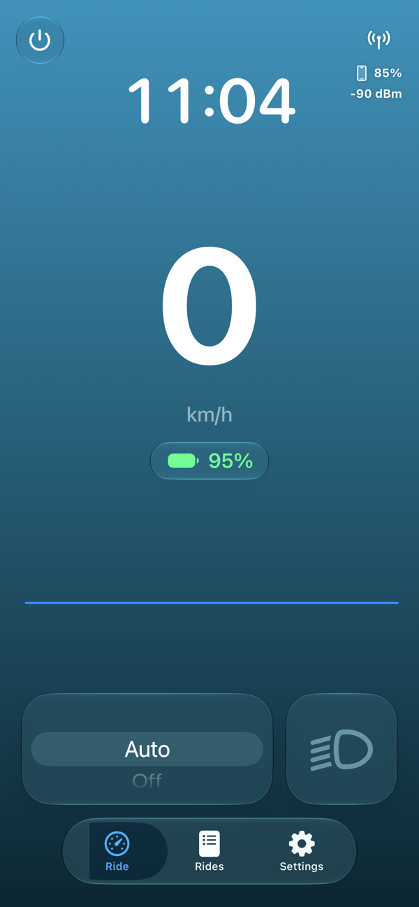
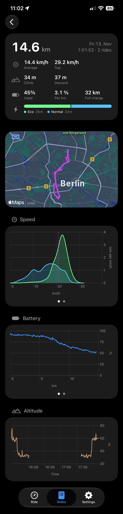
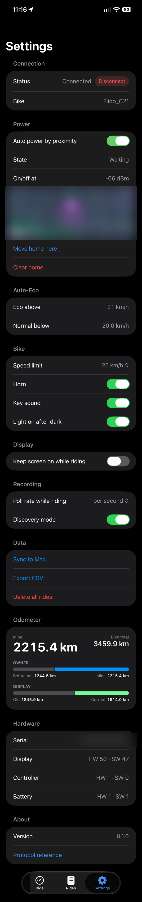
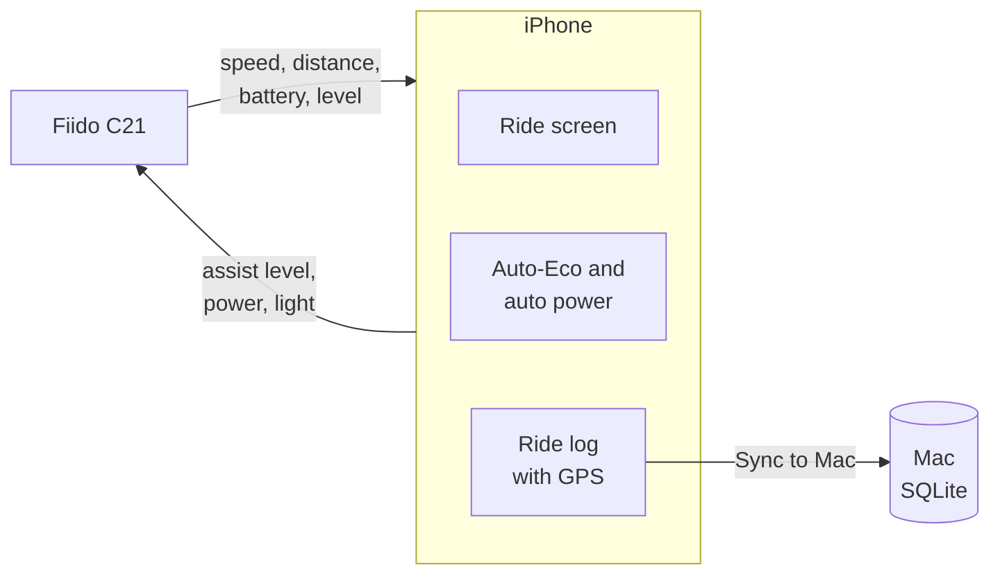
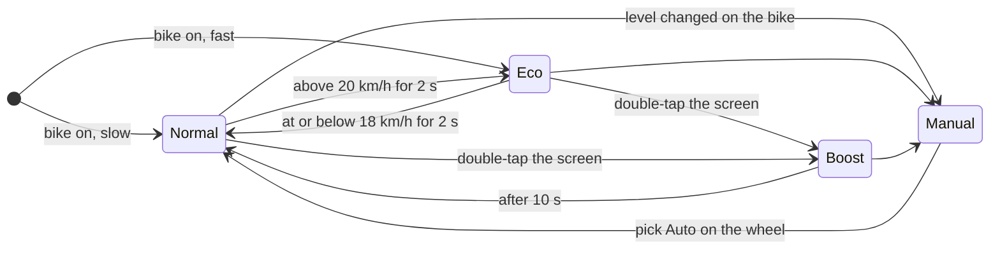

# Fiido Ride

An iOS app for the Fiido C21 e-bike. It talks to the bike over Bluetooth, shows a riding HUD, logs every frame of telemetry to an on-phone database, keeps the assist level in Eco above a set speed (Auto-Eco) and can switch the bike on and off as you walk up to it or away from it. Rides sync to a Mac as SQLite.

The bike's hardware mods (tail light) live in [momonala/fiido-c21](https://github.com/momonala/fiido-c21).

<p>
  
  
  
</p>

## Quick start

```bash
brew install xcodegen
ios-app/scripts/deploy.sh
```

This regenerates the Xcode project and calls the shared deploy script in `~/code/projects/iOS-App-Deploy` (app id `fiido` in its `config.json`). That script builds a Release, installs it over Wi-Fi and launches it. It's signed with a free Apple ID, so the install expires after 7 days; the iOS App Deploy menu bar app redeploys it before then.

For development, `cd ios-app && xcodegen generate && open FiidoRide.xcodeproj`. New Swift files under `FiidoRide/` are picked up automatically (synced folder); only `project.yml` changes need a regenerate.

On first launch, allow Bluetooth and location, and set location to "Always" in iOS Settings so GPS can start with the phone in a pocket. Close the official Fiido app first: the bike accepts only one Bluetooth connection at a time.

Sync rides to this Mac (once). It needs `uv` and a `.env` in the repo root:

```bash
brew install uv
cat > .env <<EOF
SYNC_HOST=$(scutil --get LocalHostName).local
SYNC_PORT=8765
SYNC_TOKEN=$(openssl rand -hex 16)
SYNC_DEVICE=<your iPhone's name>
EOF
sync/install.sh
```

This installs a launchd agent that keeps `sync/server.py` running. One sync by hand: `sync/sync.sh`.

Protocol and rule tests run on the Mac:

```bash
cd ios-app/FiidoKit && swift test
```

## How it works

The phone talks to the bike over Bluetooth, like the official Fiido app. It reads speed, distance, battery and assist level, and sends commands back: assist level, power and light. Every ride is saved on the phone with its GPS track, and can be synced to a Mac.



### Ride screen

A handlebar display. The big number is speed in km/h, with the clock above it, the bike's battery % below it (grey when it's the last reading, with the bike off or out of reach) and a short speed trace under that. Top right, from the top: the Bluetooth link and its signal strength, the phone's battery, the weather (an icon for sun, cloud, rain and so on, the temperature and this hour's chance of rain, as in "6° · 40%"), this ride's distance with today's total ("5 · 15 km"), and the range ("15 · 45 km": km left until empty, then the total this charge should give you, km ridden since the charge plus km left). The range row lines up with the bottom of the clock. At the bottom are the assist wheel (Auto, Off, Eco, Normal, Sport, Turbo, Turbo+) and the light. Power is in the top-left corner.

The battery % is finer than the bars on the bike's own display. It dips under load and recovers at rest, so treat range as an estimate.

### Auto-Eco

Normal assist gets you from a stop up to speed; Eco is enough to cruise. Auto, the default, switches between the two for you.



- **Boost**, for overtaking: double-tap anywhere above the assist wheel and you get Normal for 10 s at any speed.
- Change level on the bike's own display and Auto steps aside until you pick Auto on the wheel again (or tap the selected level).
- With Auto on, switching the bike on in Sport or Turbo drops it straight to Normal or Eco.
- Both speeds are set in Settings → Auto-Eco.

### Auto power

Off by default (Settings → Power). Walk away from the parked bike and it switches off; come back and it switches on. The app judges distance by Bluetooth signal strength, against the "On/off at" setting. It never switches on near home, a spot you set in Settings → Power, so the bike stays off in the garage. Each switch posts a notification. It needs the app running, and iOS can suspend it between rides.

### Light after dark

On by default (Settings → Bike). Switch the bike on after sunset and the light comes on too.

### Rides

A ride starts when the bike is switched on and ends 2 minutes after it's switched off. A ride that went nowhere is dropped. The Rides tab groups rides by day or by charge, or lists them one by one. Each opens to:

- a summary: distance, time, speed, climb and descent, battery used per km with the range that implies, and time in each assist level
- the route on a map
- charts of speed (time spent at each speed per assist level, or speed over time), battery (against distance or time) and altitude. Swipe between chart pages, pinch to zoom along the x axis, double-tap to reset.

### Odometer card

Settings has an odometer card that's specific to this bike. It was bought used, and its display, which holds the odometer, was later replaced, so the display's own reading undercounts. The card adds the old display's last reading to the current one for the bike's real total, and subtracts the total at purchase for the distance ridden since. On another bike, leave both values unset (see Configuration) and the card simply shows the display's reading.

### Sync to the Mac

Settings → Data → "Sync to Mac" copies every ride to `data/fiido.sqlite` on this Mac and shows a progress bar. Phone and Mac need to be on the same Wi-Fi. "Export CSV" in the same section shares the data as CSV files instead.

## Technical details

### Bluetooth protocol

The bike's BMS speaks the protocol reverse-engineered in [dzikus/esphome-fiido-bms](https://github.com/dzikus/esphome-fiido-bms) (`PROTOCOL.md`), and the C21 matches it. The app writes poll frames (`46 64 55 <len> <register> <xor>`) to characteristic `…FFE2` and reads replies from `…FFE1`. While riding it polls status and pedal energy 2 times a second (configurable), and motor, battery, controller, display version and speed limit on every other poll. With the bike off it polls every 5 s, or every second while auto power waits for you to come back.

A reply counts as the answer to a known poll only if its length matches that poll, because discovery blocks reuse register numbers (block `0x60` is also the display's version register).

#### Register map

The bike exposes one flat 256-byte register map: a poll may start at any address with any length and returns that slice. 240 of the 256 bytes never changed across two rides and a charge. Decoded on the C21, beyond `PROTOCOL.md`:

| Address | Meaning |
|---|---|
| `0x24` | Battery as the display's bars: coarse steps, 90 when full, never 100 |
| `0x3C` | Speed limit setting in km/h: 6, 25, or 100 for none |
| `0x3E–0x3F` | Max speed, 0.1 km/h, kept between rides |
| `0x40–0x41` | Average speed including stops, 0.1 km/h |
| `0x53–0x56` | Second copy of the odometer |
| `0x7D–0x7E` | Battery capacity, 11.6 Ah |
| `0x7F–0x80` | Battery voltage, a fixed 36.0 V (nameplate, not measured) |
| `0x9B–0x9C` | Wheel diameter, 28.0″ |
| `0x9D–0x9E` | Battery %, 1 % steps (documented upstream as motor temperature) |
| `0x9F–0xA0` | Rated power, 350 W |
| `0xD4–0xE3` | ASCII text, includes `Fiido_C21` |

The app's battery % is `0x9D–0x9E`, in the motor poll. It reads 99 on a full battery and sags under load. `0x24` is exported as `battery_bars` and not shown.

Range left is the current battery % divided by the battery used per km since the last charge (the same charge detection as the Rides tab); the charge's total adds the km ridden since that charge. The rate needs 1 km and 1 % of riding on the charge; until then, including right after charging, the previous charge's rate stands in. The C21's capability bits (STATS `0x2D–0x34`) claim a torque sensor but no energy meter, battery current sensor or battery data link. Torque, cadence, controller temperature and controller current read 0 while riding, and battery current, voltage and Wh look like placeholders, so the app shows none of them. They're still recorded and exported.

Two quirks: the odometer only keeps whole kilometres across a power cycle (x.6 km comes back as x.0 km), and the displayed speed reads about 3.7 % above GPS while distance looks right.

#### Writes

On/off settings are bits inside a register, so the app writes the whole register back with only that bit changed.

| Action | Register | Example |
|---|---|---|
| Assist level | `0x26` | Eco: `46 64 AA 01 26 01 AE` |
| Power (bit 7) | `0x27` | Off when it reads `A1`: `46 64 AA 01 27 21 8F` |
| Light (bit 3) | `0x27` | |
| Horn (bits 2–3) | `0x38` | |
| Key sound (bit 4) | `0x2C` | |
| Speed limit | value in `0x3C`, flags `0x2C` bit 7 and `0x27` bit 5 | |

Power on works because the C21 keeps answering Bluetooth while off. The app only sends power off at 0 km/h.

### Recording

- A ride opens when the controller switches on and closes after 2 minutes with the controller off or the bike silent.
- Every frame is stored raw in SwiftData along with every GPS fix. Decoding happens on read, so a protocol fix applies to old rides too.
- A ride whose odometer never moved is deleted on close, frames and GPS included.
- Discovery mode (on by default, Settings → Recording) also reads one 16-byte block of the register map per poll cycle (`46 64 55 10 <block> <xor>`, blocks `0x00`–`0xF0`), so rides record undocumented registers.
- Export writes `telemetry.csv` (one decoded row per status frame), `frames.csv` (raw hex, lossless) and `gps.csv`.

### Auto-Eco rule

- The 2 s wait and the 2 km/h gap between the two speeds stop it flapping around one speed.
- Every level it sets is written to the bike and confirmed from the next status reading. A write the bike ignores is sent once more, then Auto gives up.
- With the bike already in Eco or Normal at switch-on, Auto keeps that level until the speed rule says otherwise. From Off, Sport or Turbo it writes the right level at once.
- Boost is a state of the same rule: it writes Normal and holds it for `boostDuration`, ignoring speed. If a speed-rule write is still unconfirmed, the boost takes it over, so Auto survives whichever write lands first. It needs Auto, a live link and the bike on.
- The rule is `AutoEco` in FiidoKit; timings live in `AutoEcoConfig`.

### Auto power rule

The app reads the link's signal strength (RSSI) every poll; the Ride screen shows it next to the Bluetooth icon. One threshold, "On/off at" (default −70 dBm), separates near from away. Switching on needs two readings in a row at or above it, so one stray strong reading can't trigger it. Settings → Power shows the rule's state.

| State | Meaning | Next |
|---|---|---|
| Waiting | Bike off but not Away, or on and not yet near or moved since switch-on | Armed once the signal reaches the threshold or the bike moves |
| Armed | Walk-away check active | Leaving when below the threshold at 0 km/h |
| Leaving | Below the threshold, counting | Switching off after 3 s |
| Switching off | Off command sent (the bike doesn't acknowledge writes) | Away when the bike reports off; one resend after 3 s, then give up |
| Away | Off because you left: auto-off, or the link dropped for at least 60 s | Switch on once the signal reaches the threshold, unless home |

- **Home:** "Set home here" saves a GPS fix on the phone. Within 100 m of it the bike is never switched on; switch-off still works. The check uses iOS's last known position, usually where the last ride ended, so in practice it means "the bike is parked at home".
- A disconnect the app asked for, an app relaunch, or switching the bike off by hand while staying near it never leads to an auto-on. Walking out of range for a minute after a manual switch-off does count as Away.
- If you come back near the bike, or it moves, before a missed off command is resent, the resend is cancelled and the rule is Armed again.
- Notifications show even with the app open. Permission is requested when the toggle is turned on.
- Timings live in `AutoPowerConfig` (FiidoKit).

### Sunset calculation

On an off-to-on switch, the app turns the light on if the sun is below −0.833° (the standard sunset elevation) at the phone's last known position. `Sun` in FiidoKit computes it on the phone. Connecting to a bike that's already on leaves the light alone.

### Ride grouping and charts

- A charge group starts at each ride that began at least 10 points above where the previous ride ended. The level recovers a few points at rest, so a smaller jump isn't a charge.
- Battery "used" for a day or charge is the sum over its rides, so charging between rides doesn't hide it. A ride that ends higher than it started counts as 0.
- Time per assist level, and the speed curves, count only time moving: Auto-Eco sits in Normal at a standstill.
- Each speed curve spreads every reading over about ±1 km/h, in minutes per km/h, so its area is the time spent in that level.
- Climb and descent come from GPS altitude, averaged over 15 fixes and ignoring swings under 3 m.
- Day and charge charts are averaged down to 300 points.

### Sync internals

`sync/sync.sh` copies the SwiftData store (`default.store` plus its `-wal` and `-shm` files) out of the app's container with `xcrun devicectl device copy from`. That uses the same Wi-Fi pairing as deploys, so the app needs no sync code of its own beyond the button. The files land in a temp folder, `fiido-convert` (in FiidoKit) turns them into `data/fiido.sqlite`, and only then is the raw copy kept in `data/raw/`. A copy broken by a write mid-copy never replaces the last good one. The SQLite file has tables `rides`, `frames` (register as `0x..` text, raw payload blobs), `gps` and `telemetry` (decoded like `telemetry.csv`). Times are ISO 8601 UTC text.

The app's "Sync to Mac" button calls `GET http://<SYNC_HOST>:<SYNC_PORT>/sync` with the token as a bearer header; `server.py` answers 404 to anything else. Log: `~/Library/Logs/fiido-sync.log`. `sync.sh` assumes Xcode is at `/Applications/Xcode.app`.

### Weather

The HUD asks [Open-Meteo](https://open-meteo.com) (free, no account or key) for the current temperature, a weather code and this hour's chance of rain. It asks every 15 minutes while the Ride screen is open, or every minute until the first answer, using the phone's last known position rounded to 2 decimals (about 1 km) before it leaves the phone. Logic and the code-to-icon mapping are `Weather` in FiidoKit.

### Background

The `bluetooth-central` and `location` background modes keep the app alive while a ride is open. GPS runs then, and that's what keeps polling and Auto-Eco going with the phone locked. If iOS ends the app in the background, Bluetooth state restoration relaunches it when the bike connects, unless the app was swiped away.

## Configuration

- **`.env`** (repo root, gitignored): `SYNC_HOST`, `SYNC_PORT`, `SYNC_TOKEN` and `SYNC_DEVICE`, as in Quick start. `server.py` and `sync.sh` read it, and `ios-app/Config.xcconfig` includes it, so the app build picks up host, port and token. Gotcha: because of that include, use plain `KEY=value` lines only; a `#` comment line breaks the build. Without the file the Sync button is hidden.
- **In-app settings** are stored in `UserDefaults`; the keys and defaults are in `ios-app/FiidoRide/AppSettings.swift`. Rule defaults come from FiidoKit (`AutoEcoConfig`, `AutoPowerConfig`).
- **Bike-specific values:** `ios-app/Local.xcconfig`, gitignored so they stay out of this public repo:
  - `BIKE_SERIAL = <number>`. Without it the Serial row is hidden.
  - `PURCHASE_ODOMETER_KM` (bike total when you bought it) and `OLD_DISPLAY_KM` (the old display's reading, if the display was ever replaced), for the odometer card: bike total = old display + current display; "Mine" = bike total − purchase reading. Each counts as 0 when unset.
- **App icon:** the committed icon was made from a bike photo that isn't in the repo. To make one from your own photo, from `ios-app/`: `uv run design/make_icon.py <photo>.png FiidoRide/Assets.xcassets/AppIcon.appiconset/icon-1024.png`.

## Project structure

```
.
├── ios-app/
│   ├── project.yml              XcodeGen spec; .xcodeproj and Info.plist are generated, not committed
│   ├── Config.xcconfig          includes Local.xcconfig and ../.env
│   ├── scripts/deploy.sh        build and install on the iPhone
│   ├── design/make_icon.py      app icon from your own bike photo (see Configuration)
│   ├── FiidoKit/                Swift package, no Bluetooth or UI code
│   │   ├── Sources/FiidoKit/    frames, register decoding, telemetry rows, Auto-Eco and auto power
│   │   │                        rules, sun position, elevation and speed-density maths
│   │   ├── Sources/FiidoConvert/  fiido-convert: app store → SQLite, used by the Mac sync
│   │   └── Tests/FiidoKitTests/ tests against a real C21 capture
│   └── FiidoRide/               the app
│       ├── Bike/                CoreBluetooth connection and poll loop, location tracker
│       ├── Storage/             SwiftData models, day/charge grouping, ride recorder, CSV export, Mac sync
│       └── Views/               RideView, RidesView, SettingsView (one per tab) and Shared
├── sync/                        Mac side: sync.sh (pull and convert), server.py (listener),
│                                install.sh (launchd agent)
└── data/                        gitignored: the synced database; holds GPS tracks, never committed
```
